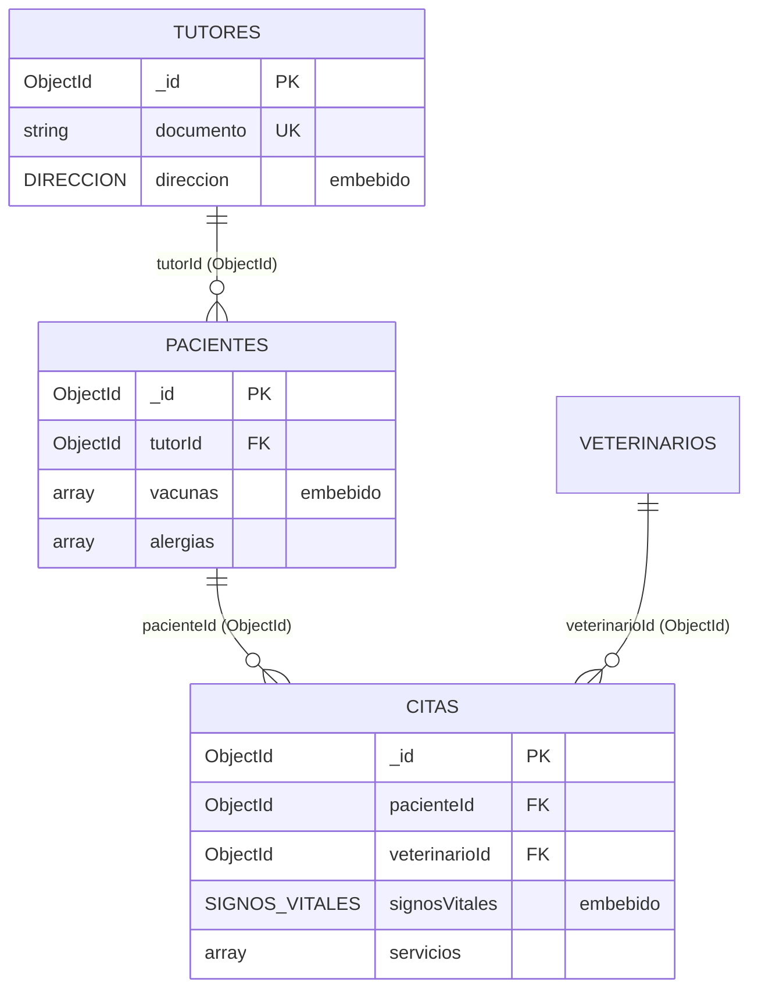

# Informe técnico — Proyecto Final MongoDB

**Aplicación:** Huellas · Clínica Veterinaria  
**Tecnologías:** Node.js, Express, EJS, MongoDB (driver oficial)  
**Fecha de entrega:** 24 de noviembre de 2026  
**Estudiante:** Sergio Olier Meza - Christian Ardila Gonzales
**Profesor:** Ing. Carlos Alberto García Castro — Electiva IV  
**Fundación Universitaria Tecnológico Comfenalco**

---

## 1. Problema de negocio y objetivo

Una clínica veterinaria maneja simultáneamente tutores, pacientes, profesionales y una agenda de citas que crece a diario. El problema que resuelve la aplicación es la **dispersión de información clínica y administrativa**:historias, vacunas, signos vitales, responsables y facturación deben consultarse de forma rápida y confiable, sin perder integridad al eliminar registros.

El objetivo es diseñar e implementar una aplicación web que use **MongoDB como base de datos principal**, con:

- Modelo de documentos con embebidos, referencias por `ObjectId` y arreglos.
- Operaciones CRUD desde la interfaz web con validación.
- Integridad de referencias al eliminar.
- Al menos tres consultas de agregación que respondan preguntas de negocio reales.
- Datos iniciales suficientes para demostrar consultas avanzadas (1820 documentos).

---

## 2. Alcance y dominio

Dominio elegido: **clínica veterinaria**. Es pertinente porque combina entidades con relaciones claras (un tutor tiene varios pacientes; un paciente tiene muchas citas; un veterinario atiende muchas citas) y datos que naturalmente se embeben (signos vitales de una cita, dirección de un tutor).

Colecciones implementadas:

| Colección | Función | Documentos en la semilla |
|---|---|---:|
| `tutores` | Responsables de los pacientes | 120 |
| `pacientes` | Historias clínicas y datos del animal | 260 |
| `veterinarios` | Profesionales de la clínica | 40 |
| `citas` | Agenda, signos vitales, servicios y facturación | 1400 |
| **Total** |  | **1820** |

---

## 3. Modelo de datos

### 3.1 Diagrama

El diagrama Mermaid completo está en [`diagrama_modelo.mmd`](diagrama_modelo.mmd) y puede visualizarse en GitHub, VS Code o Mermaid Live.



### 3.2 Decisiones de diseño

| Mecanismo | Dónde se aplica | Justificación |
|---|---|---|
| **Documentos embebidos** | `tutores.direccion`, `citas.signosVitales`, elementos de `pacientes.vacunas` | Se leen y actualizan siempre junto al documento padre. La dirección no existe sin el tutor y los signos vitales no existen sin la cita; embeberlos evita `$lookup` innecesarios y permite actualizarlos con un solo `$set`. |
| **Referencias (`ObjectId`)** | `pacientes.tutorId`, `citas.pacienteId`, `citas.veterinarioId` | Tutores, pacientes y veterinarios tienen vida propia, se consultan de forma independiente y pueden crecer sin límite. Referenciar evita duplicar datos y facilita integridad. |
| **Arrays** | `pacientes.vacunas`, `pacientes.alergias`, `citas.servicios` | Son listas acotadas que pertenecen al documento. Se manipulan con `$push`, `$pull` y `$addToSet` desde la interfaz. |

Regla aplicada: **embeber lo que se lee y se actualiza junto; referenciar lo que crece sin límite o tiene vida propia**.

---

## 4. Índices

| Índice | Colección | Consulta que mejora |
|---|---|---|
| `ux_tutores_documento` (unique) | `tutores` | Búsqueda por documento y prevención de duplicados. |
| `ix_tutores_email` | `tutores` | Filtro de tutores por correo. |
| `ix_tutores_ciudad` | `tutores.direccion.ciudad` | Filtro por ciudad en el listado. |
| `ix_pacientes_tutorId` | `pacientes` | `$lookup` desde `pacientes` y consulta "pacientes de un tutor". |
| `ix_pacientes_especie` | `pacientes` | Filtro por especie y agregación por especie. |
| `ux_veterinarios_licencia` (unique) | `veterinarios` | Validación de licencia única. |
| `ix_veterinarios_activos_especialidad` | `veterinarios` | Selects y filtros del listado. |
| `ix_citas_pacienteId` | `citas` | `$lookup` de paciente en reportes e historial clínico. |
| `ix_citas_veterinarioId` | `citas` | `$lookup` de veterinario en el reporte 1. |
| `ix_citas_fecha` | `citas` | Orden cronológico y filtros de rango. |
| `ix_citas_estado_fecha` | `citas` | `$match` por estado más rango de fechas. |

Los campos foráneos (`pacienteId`, `veterinarioId`, `tutorId`) están indexados precisamente porque son los campos de la colección foránea usados por `$lookup`.

---

## 5. Validación e integridad

### 5.1 Validación en la aplicación

`src/utils/validacion.js` valida longitud, formato de documento/teléfono/licencia, correo, rangos numéricos, fechas, enumeraciones y existencia de referencias antes de insertar o actualizar.

### 5.2 Validación de esquema en MongoDB

`src/config/schema.js` define `$jsonSchema` para las cuatro colecciones con `validationLevel: 'strict'` y `validationAction: 'error'`. Ejemplos:

- `tutores.documento`: `^[0-9]{6,12}$`.
- `pacientes.especie`: `enum: ['Perro','Gato','Ave','Reptil','Otro']`.
- `citas.estado`: `enum: ['Programada','En consulta','Completada','Cancelada']`.
- `citas.duracionMin`: entre 15 y 180.
- `citas.signosVitales.temperatura`: entre 34 y 43.

### 5.3 Integridad al eliminar

| Entidad | Comportamiento |
|---|---|
| Tutor | No se elimina si tiene pacientes asociados. |
| Paciente | No se elimina si tiene citas asociadas. |
| Veterinario | No se elimina si tiene citas asociadas. |
| Cita | Se elimina directamente porque no tiene dependientes. |

### 5.4 Configuración segura

La cadena de conexión se lee desde `MONGODB_URI` en `.env`; `.env` está en `.gitignore`. No hay credenciales en el código fuente. El manejo de errores es centralizado y se contemplan errores de índice único (`11000`).

---

## 6. CRUD funcional

| Requisito | Implementación | Operadores / pantallas |
|---|---|---|
| RF-01 Crear | Formularios con validación para las 4 colecciones. | `insertOne` · `/tutores/nuevo`, `/pacientes/nuevo`, `/veterinarios/nuevo`, `/citas/nueva` |
| RF-02 Leer | Listados con búsqueda/filtros y vistas de detalle. | `find`, `aggregate` con `$lookup` · `/tutores`, `/pacientes`, `/veterinarios`, `/citas` |
| RF-03 Actualizar | Edición de campos simples, subdocumentos y arreglos. | `$set` (también sobre `signosVitales`), `$push`, `$pull`, `$addToSet` |
| RF-04 Eliminar | Borrado con verificación previa de dependencias. | `countDocuments` + `deleteOne` |
| RF-05 Reportes | Sección con 4 agregaciones documentadas. | `/reportes` |
| RF-06 Validación | Doble capa: aplicación y `$jsonSchema`. | `src/utils/validacion.js`, `src/config/schema.js` |

---

## 7. Consultas avanzadas con `aggregate`

Todas se ejecutan en la colección `citas` desde `/reportes`. En conjunto usan `$match`, `$group`, `$sort`, `$lookup`, `$unwind`, `$project`, `$addFields` y `$limit`.

### 7.1 Reporte 1 — Citas completadas por veterinario

**Pregunta de negocio:** ¿Cuántas citas completó cada veterinario y cuántos ingresos generó?

**Pipeline:**

```js
[
  { $match: { estado: 'Completada' } },
  {
    $lookup: {
      from: 'veterinarios',
      localField: 'veterinarioId',
      foreignField: '_id',
      as: 'veterinario'
    }
  },
  { $unwind: '$veterinario' },
  {
    $group: {
      _id: {
        veterinario: '$veterinario.nombre',
        especialidad: '$veterinario.especialidad'
      },
      totalCitas: { $sum: 1 },
      ingresos: { $sum: '$costo' },
      duracionPromedio: { $avg: '$duracionMin' }
    }
  },
  {
    $project: {
      _id: 0,
      veterinario: '$_id.veterinario',
      especialidad: '$_id.especialidad',
      totalCitas: 1,
      ingresos: { $round: ['$ingresos', 2] },
      duracionPromedio: { $round: ['$duracionPromedio', 1] }
    }
  },
  { $sort: { totalCitas: -1 } }
]
```

**Ejemplo de resultado (semilla):**

| Veterinario | Especialidad | Citas | Ingresos | Duración prom. |
|---|---|---:|---:|---:|
| Dr. Liliana María Cárdenas | Dermatología | 29 | $ 4.090 | 63,1 min |
| Dr. Claudia Patricia González | Dermatología | 28 | $ 4.040 | 64,3 min |
| Dr. Liliana María Ramírez | Dermatología | 24 | $ 3.480 | 58,8 min |

**Interpretación:** identifica al profesional con mayor carga y su aporte económico; útil para incentivos y para distribuir la agenda.  
**Pantalla:** `/reportes` → "Citas completadas por veterinario".

---

### 7.2 Reporte 2 — Gasto promedio por especie

**Pregunta de negocio:** ¿Cuál es el gasto promedio por cita según la especie del paciente?

**Pipeline:**

```js
[
  { $match: { estado: 'Completada' } },
  {
    $lookup: {
      from: 'pacientes',
      localField: 'pacienteId',
      foreignField: '_id',
      as: 'paciente'
    }
  },
  { $unwind: '$paciente' },
  {
    $group: {
      _id: '$paciente.especie',
      totalCitas: { $sum: 1 },
      gastoPromedio: { $avg: '$costo' },
      ingresos: { $sum: '$costo' }
    }
  },
  {
    $project: {
      _id: 0,
      especie: '$_id',
      totalCitas: 1,
      gastoPromedio: { $round: ['$gastoPromedio', 2] },
      ingresos: { $round: ['$ingresos', 2] }
    }
  },
  { $sort: { gastoPromedio: -1 } }
]
```

**Ejemplo de resultado (semilla):**

| Especie | Citas | Gasto promedio | Ingresos |
|---|---:|---:|---:|
| Perro | 117 | $ 152,22 | $ 17.810 |
| Gato | 133 | $ 145,71 | $ 19.380 |
| Reptil | 120 | $ 143,08 | $ 17.170 |
| Otro | 125 | $ 138,08 | $ 17.260 |
| Ave | 132 | $ 134,70 | $ 17.780 |

**Interpretación:** muestra qué especies tienen mayor ticket promedio. Permite ajustar precios, campañas y disponibilidad de especialistas.  
**Pantalla:** `/reportes` → "Gasto promedio por especie".

---

### 7.3 Reporte 3 — Top 5 de pacientes con más servicios

**Pregunta de negocio:** ¿Qué pacientes recibieron más servicios y cuánto facturaron?

**Pipeline:**

```js
[
  { $match: { estado: 'Completada' } },
  { $addFields: { cantidadServicios: { $size: '$servicios' } } },
  {
    $lookup: {
      from: 'pacientes',
      localField: 'pacienteId',
      foreignField: '_id',
      as: 'paciente'
    }
  },
  { $unwind: '$paciente' },
  {
    $lookup: {
      from: 'tutores',
      localField: 'paciente.tutorId',
      foreignField: '_id',
      as: 'tutor'
    }
  },
  { $unwind: '$tutor' },
  {
    $group: {
      _id: {
        paciente: '$paciente.nombre',
        tutor: { $concat: ['$tutor.nombre', ' ', '$tutor.apellido'] },
        especie: '$paciente.especie'
      },
      totalCitas: { $sum: 1 },
      totalServicios: { $sum: '$cantidadServicios' },
      ingresos: { $sum: '$costo' }
    }
  },
  {
    $project: {
      _id: 0,
      paciente: '$_id.paciente',
      tutor: '$_id.tutor',
      especie: '$_id.especie',
      totalCitas: 1,
      totalServicios: 1,
      ingresos: { $round: ['$ingresos', 2] }
    }
  },
  { $sort: { totalServicios: -1 } },
  { $limit: 5 }
]
```

**Ejemplo de resultado (semilla):**

| Paciente | Tutor | Especie | Citas | Servicios | Ingresos |
|---|---|---|---:|---:|---:|
| Vera | Gloria Stella Núñez | Otro | 9 | 20 | $ 1.510 |
| Bruno | Adriana Ximena Jiménez | Gato | 6 | 17 | $ 970 |
| Kira | Gloria Stella Núñez | Perro | 7 | 16 | $ 900 |
| Rex | Manuel Francisco Rivera | Reptil | 8 | 16 | $ 1.140 |
| Mía | Manuel Francisco Rivera | Gato | 7 | 15 | $ 740 |

**Interpretación:** identifica clientes frecuentes para fidelización y seguimiento clínico. `$addFields` con `$size` evita duplicar el costo al contar servicios.  
**Pantalla:** `/reportes` → "Top 5 de pacientes con más servicios".

---

### 7.4 Reporte 4 — Evolución mensual de citas

**Pregunta de negocio:** ¿Cómo evolucionaron las citas y los ingresos mes a mes en el último año? Se toma como fecha de corte la fecha de referencia de la semilla (`2026-11-23`) para que el ejemplo sea reproducible.

**Pipeline** (el código calcula `inicio` como un año antes de la fecha de corte):

```js
const fin = new Date('2026-11-23T10:00:00.000Z');
const inicio = new Date(fin);
inicio.setFullYear(inicio.getFullYear() - 1);

[
  { $match: { fecha: { $gte: inicio, $lte: fin } } },
  {
    $group: {
      _id: { $dateToString: { format: '%Y-%m', date: '$fecha' } },
      totalCitas: { $sum: 1 },
      ingresos: { $sum: '$costo' }
    }
  },
  {
    $project: {
      _id: 0,
      mes: '$_id',
      totalCitas: 1,
      ingresos: { $round: ['$ingresos', 2] }
    }
  },
  { $sort: { mes: 1 } }
]
```

**Ejemplo de resultado (semilla, primeros meses):**

| Mes | Citas | Ingresos |
|---|---:|---:|
| 2025-11 | 19 | $ 2.560 |
| 2025-12 | 111 | $ 16.560 |
| 2026-01 | 109 | $ 16.080 |

**Interpretación:** detecta temporadas de alta y baja demanda para planear horarios, inventario y campañas preventivas.  
**Pantalla:** `/reportes` → "Evolución mensual de citas".

---

## 8. Datos iniciales

La semilla es determinista (PRNG `mulberry32` con semilla `20261123`) y usa como fecha de referencia el `2026-11-23`. Esto permite reproducir los ejemplos del informe.

```bash
npm run setup
npm run seed
npm run verify
```

`npm run verify` imprime los conteos y ejecuta los cuatro pipelines por consola como evidencia adicional para la sustentación.

---

## 9. Entregables y sustentación

| Entregable | Ubicación |
|---|---|
| Código fuente | `src/`, `scripts/` |
| Informe técnico | `informe/informe_tecnico.md` |
| Diagrama | `informe/diagrama_modelo.mmd` |
| Configuración segura | `.env.example`, `.gitignore` |
| Datos iniciales | `npm run seed` (1820 documentos) |

**Guion de demostración en vivo:**

1. Panel `/`: totales y últimas citas.
2. Crear tutor → paciente → cita desde formularios.
3. En paciente: agregar vacuna con `$push`, eliminarla con `$pull`, agregar alergia con `$addToSet`.
4. Editar cita: modificar signos vitales (subdocumento) con `$set`.
5. Intentar eliminar un tutor con pacientes: bloqueo por integridad.
6. `/reportes`: explicar los 4 pipelines, ejemplos e interpretaciones.
7. `npm run verify`: conteos y resultados en consola.

---

## 10. Conclusión

El proyecto cumple los objetivos de la electiva: modela un dominio real con los tres mecanismos de MongoDB, ofrece CRUD validado desde una interfaz web, protege la integridad de las referencias y demuestra consultas avanzadas con agregación. La arquitectura es ordenada, las credenciales quedan fuera del código y los índices responden tanto a los filtros como a las uniones `$lookup`.
